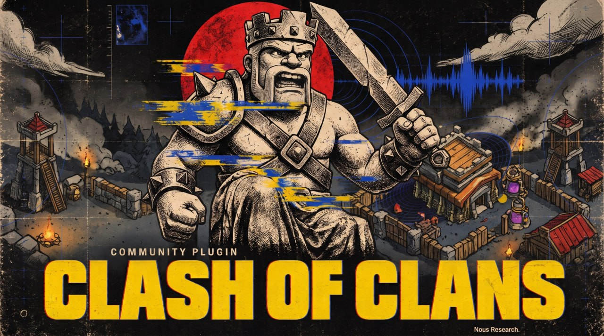

<p align="center">
  
</p>

<h1 align="center">Clash Of Clans</h1>

<p align="center">
  <strong>A Community Plugin for Hermes Agent</strong><br>
  by <em>Nous Research</em>
</p>

<p align="center">
  <code>v1.0.0</code> · <code>Hermes ≥ 0.21.5</code> · <code>7 tools</code> · <code>35 API endpoints</code> · <code>Python standard library only</code>
</p>

---

## Overview

Clash Of Clans gives Hermes Agent the ability to read Clash of Clans account, clan, war, league, ranking, and progression data through the [official Supercell API](https://developer.clashofclans.com/). It also includes one tool that reads the game's village export file and calculates when buildings, troops, heroes, helpers, and cooldowns will finish.

The plugin is designed around a simple rule: **one tool, one clear purpose**. A single tool may call several API endpoints internally, so the agent never has to choose between 35 separate endpoints.

All examples in this document use **placeholders**. Replace `<player-tag>`, `<clan-tag>`, and `<one-time-game-token>` with your own values.

What this plugin **does**:

- Reads public game data for a player tag or clan tag.
- Verifies that a person controls a specific player account.
- Parses a village export and produces upgrade finish times and reminder windows.

What this plugin **does not do**:

- It does not play the game or change any village.
- It cannot start, cancel, or speed up an upgrade.
- It never asks for a Supercell ID, email address, or password.

---

## Credentials

Two different credentials are involved. They are **not interchangeable**.

| Credential | Where it comes from | Used by | Stored? |
|---|---|---|---|
| **Developer JWT** | [Supercell developer portal](https://developer.clashofclans.com/) | All six data tools | Yes, as `COC_API_TOKEN` in Hermes secrets (`hermes config` / dashboard Keys) |
| **One-time game token** | Inside the game: `Settings → More Settings → API Token` | `coc_verify` only | No, discarded after verification |
| **No credential** | Village export JSON | `coc_timer` | Optional export file |

### 1. Developer JWT — required for the six data tools

This token authenticates the plugin to Supercell's official API. Create it as follows:

1. Open the [Supercell developer portal](https://developer.clashofclans.com/).
2. Register or log in.
3. Open **My Account → Create New Key**.
4. Fill in:
   - **Key name:** `hermes-vps`
   - **Description:** `Hermes Clash Of Clans plugin`
   - **Allowed IP:** the public IP of the machine running Hermes
5. Create the key and copy the JWT.
6. Store it as `COC_API_TOKEN` in Hermes secrets — via `hermes config` or the dashboard Keys page (not a plain `.env` file).

Check the public IP of the machine that runs Hermes:

```bash
curl -4 ifconfig.me
```

Example output: `<your-public-ip>`

> **Important:** the allowed IP must be the IP of the machine that actually calls the API. If Hermes runs on a VPS, whitelist the VPS IP. An unstable home Wi-Fi IP is not needed and should not be used.

The plugin does not read `.env` directly. It resolves the secret through Hermes' public API:

```python
from agent.secret_scope import get_secret
get_secret("COC_API_TOKEN", "")
```

### 2. One-time game token — only for `coc_verify`

This token proves that the person making the request controls a specific player tag.

Get it inside the game:

```text
Settings → More Settings → scroll to the bottom → API Token → Show → Copy
```

Properties:

- Single use.
- Changes every time `Show` is pressed.
- Expires after a few minutes.
- Cannot be used to log in, buy items, or modify the account.

Example request through Hermes:

```text
Verify account <player-tag> with token <one-time-game-token>
```

Successful response:

```json
{"tag":"<player-tag>","status":"ok","verified":true}
```

### 3. Village export — no token needed for `coc_timer`

Copy the village export from inside the game:

```text
Settings → More Settings → Export village data in JSON format → Copy
```

Save it, for example, to `~/coc-export.json`, or paste it directly into Hermes.

---

## Tools

The plugin exposes **seven tools** under the toolset name **`Clash Of Clans`** — with spaces and no hyphen.

| # | Tool | Purpose | Endpoints | Credential |
|---:|---|---|---:|---|
| 1 | `coc_verify` | Confirms that a player tag belongs to the person making the request | 1 | One-time game token |
| 2 | `coc_player` | Reads a player profile, hero levels, recent battles, and league history | 3 | Developer JWT |
| 3 | `coc_clan` | Reads clan details, members, current war, war log, CWL, and capital raids | 8 | Developer JWT |
| 4 | `coc_league` | Reads league tier, ranked league group, seasons, and league catalog counts | 13 | Developer JWT |
| 5 | `coc_ranks` | Reads local and global leaderboards for clans, players, Builder Base, and capitals | 7 | Developer JWT |
| 6 | `coc_meta` | Reads the current Gold Pass season, player/clan labels, and league counts | 3 | Developer JWT |
| 7 | `coc_timer` | Parses a village export and calculates upgrade finish times and alarm windows | 0 | None |

Total official API endpoints covered: **35**.

The endpoint list follows the [Clash of Clans API documentation](https://github.com/MasiaAntoine/clash-of-clan-api-doc-official).

### Tool details

#### `coc_verify`

**What it does:** sends the one-time token from inside the game to Supercell's verification endpoint. This is an identity check, not a data query.

**Returns:** the player tag, HTTP status, verification status, and a boolean `verified` field.

**Use it for:** linking a Discord or Telegram user to a Clash of Clans account.

**Important:** the game token is consumed once and must never be stored by the caller.

#### `coc_player`

**What it does:** reads the main player profile and combines it with the player's battle log and league history.

**Returns:** name, tag, Town Hall level, Builder Hall level, experience, trophies, best trophies, Builder Base trophies, war stars, donations, capital contributions, clan, league tier, Builder Base league, hero levels, recent battles, and history counts.

**Use it for:** answering "what is my account like?" and "is this account active?"

#### `coc_clan`

**What it does:** gathers clan information and all war-related context for a clan tag.

**Returns:** clan name, level, type, member count, points, top donors, current war state, war stars, opponent, the caller's attacks if a player tag is supplied, war log summary, CWL status, and capital raid season count.

**Use it for:** clan overviews, war performance reviews, and finding the most active donors.

#### `coc_league`

**What it does:** resolves the current player's league tier and ranked league group, then reads the relevant league catalogs.

**Returns:** league tier, Builder Base league, current league group tag and season ID, ranked group member/attack/defense counts, recent Legend League season IDs, and counts of leagues, tiers, war leagues, capital leagues, and Builder Base leagues.

**Use it for:** understanding which competitive league a player is in and what that league's current group looks like.

#### `coc_ranks`

**What it does:** resolves a location by name and reads five different leaderboards for that location.

**Returns:** location details and ranked rows for clans, players, Builder Base players, Builder Base clans, and capitals.

**Use it for:** answering "who is ranked near me?" or "what are the top clans in my country?"

#### `coc_meta`

**What it does:** reads global reference data that is not tied to one player or clan.

**Returns:** current Gold Pass start and end times, player label count and sample names, clan label count and sample names, and counts of leagues, league tiers, and war leagues.

**Use it for:** Gold Pass timing and general game reference data.

#### `coc_timer`

**What it does:** parses a village export JSON file and converts each `timer` value into an absolute finish time.

**Returns:** a sorted list of pending items with location, item name, level, remaining seconds, finish time, one-hour alarm, fifteen-minute alarm, and status. It can also save the parsed result to `state/upgrades.json`.

**Use it for:** reminder workflows such as "tell me 15 minutes before the Grand Warden finishes."

---

## Example prompts

| Request | Tool used |
|---|---|
| `Check my Clash of Clans account` | `coc_player` |
| `Show my clan and the last war` | `coc_clan` |
| `Rank players in my country` | `coc_ranks` |
| `What league am I in?` | `coc_league` |
| `When does the Gold Pass end?` | `coc_meta` |
| `When will my builders finish?` | `coc_timer` |
| `Link <player-tag> with <one-time-game-token>` | `coc_verify` |

---

## Upgrade timers

The official API does not expose running builder timers. The game's village export does.

The calculation is:

```text
finish = export timestamp + timer value in seconds
```

Default alarm windows are **1 hour** and **15 minutes** before finish time.

Example result:

```json
{
  "name": "Blacksmith",
  "finish": "2026-11-18 12:13:19",
  "alarm1h": "2026-11-18 11:13:19",
  "alarm15m": "2026-11-18 11:58:19",
  "status": "scheduled"
}
```

### Caveats

- `helper_recurrent` may make an upgrade finish earlier than the raw timer suggests.
- Clock Tower boosts can accelerate Builder Base work.
- Using a potion, book, or gem finish requires a fresh export.
- Unknown `data` IDs are reported exactly as received instead of being guessed.

The bundled `mapping.json` maps game data IDs to building, troop, and hero names.

---

## Project layout

```text
Clash Of Clans/
├── plugin.yaml          # manifest: name, version, provides_tools
├── __init__.py          # register(ctx) entry point
├── tools.py             # seven schemas, handlers, and register_tools()
├── mapping.json         # data ID → building / troop / hero name mapping
├── assets/
│   └── banner.jpg       # community plugin banner
└── state/
    └── upgrades.json    # generated by coc_timer when save=true
```

---

## Installation and validation

The plugin is installed at:

```text
~/.hermes/plugins/Clash Of Clans/
```

Validate it:

```bash
hermes plugins validate ~/.hermes/plugins/clash-of-clans
```

Enable it:

```bash
hermes plugins enable "Clash Of Clans"
hermes gateway restart
```

Verify it:

```bash
hermes tools list
```

Or from chat:

```text
tool_search("Clash Of Clans")
```

See the [Hermes plugin guide](https://hermes-agent.nousresearch.com/docs/developer-guide/plugins) for the full plugin contract.

Current status: **enabled and verified on Hermes v0.23.2**.

---

## Security and privacy

- The developer JWT stays in Hermes secrets, resolved only through `get_secret` — never read from the process environment.
- The game token is consumed once and never stored.
- Never paste the JWT into a chat or public repository. Rotate it if exposed.
- The plugin only reads data. It does not modify an account or a village.
- No core tool overrides and no built-in tool collisions.
- Imports are limited to the Python standard library and `agent.secret_scope`, a public Hermes API.
- No Supercell ID, email address, or password is required.

---

## Limitations

| Area | Limitation |
|---|---|
| Building timers | No official endpoint exists; `coc_timer` uses the village export instead |
| CWL | CWL endpoints only return data while the clan is in Clan War League |
| League seasons | `/leagues/{id}/seasons` works only for Legend League |
| IP allowlist | The allowed IP must match the machine calling the API |
| Billing | This plugin is unrelated to Google or Supercell billing systems |

---

<p align="center">
  <em>Built for Hermes Agent · Community Plugin · Nous Research</em>
</p>
